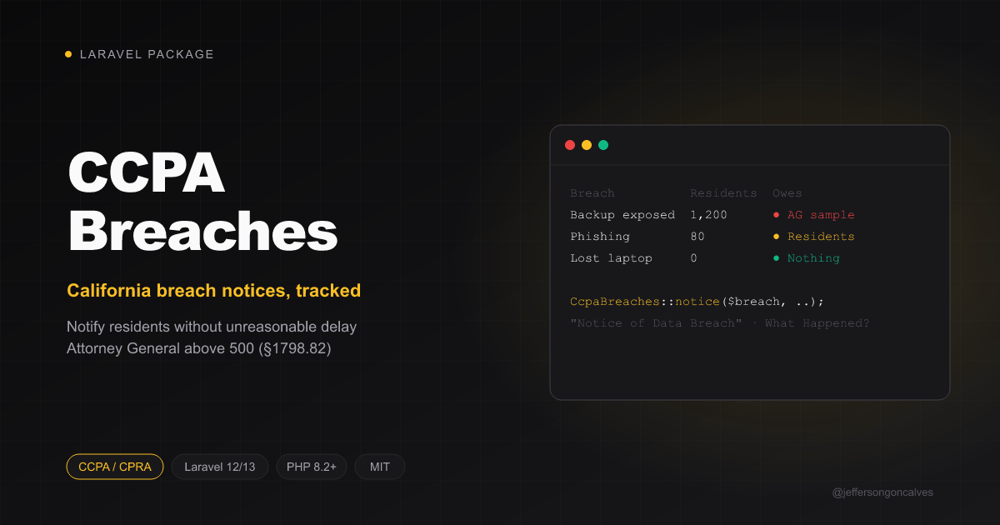

# Laravel CCPA Breaches



[](https://packagist.org/packages/jeffersongoncalves/laravel-ccpa-breaches)
[](https://github.com/jeffersongoncalves/laravel-ccpa-breaches/actions/workflows/tests.yml)
[](https://packagist.org/packages/jeffersongoncalves/laravel-ccpa-breaches)

Breach register for California's data breach notification law (Cal. Civ. Code §1798.82). It is part of the [laravel-ccpa](https://github.com/jeffersongoncalves/laravel-ccpa) suite. Breaches of nonencrypted and nonredacted personal information caused by a lack of reasonable security can also lead to consumer lawsuits under the CCPA (§1798.150).

- **No fixed deadline, your own target:** California asks you to notify affected residents "in the most expedient time possible and without unreasonable delay". The package counts down to a target you choose (30 days by default) and alerts you when you pass it.
- **Assessment:** whether notification is required, depending on the information involved (§1798.82(h)) and whether it was encrypted with a key that stayed safe. You record the reasoning.
- **Law-enforcement delay:** when the police ask you to wait because notifying would impede an investigation, record it and the clock stops (§1798.82(c)).
- **Attorney General:** above 500 California residents, submit a sample copy of the notice to the Attorney General (§1798.82(f)). The register tracks it and won't let you close the breach until you do.
- **Notice of Data Breach:** builds the notice with the title and headings §1798.82(d)(1) requires, in order.

> This package gives you tooling. It does not make you compliant on its own. Other states and federal rules (e.g. HIPAA) may also apply.

## Installation

```bash
composer require jeffersongoncalves/laravel-ccpa-breaches
php artisan vendor:publish --tag="ccpa-breaches-migrations"
php artisan migrate
php artisan vendor:publish --tag="ccpa-breaches-config"   # optional: target_days, attorney_general_threshold
```

## Usage

```php
use JeffersonGoncalves\CcpaBreaches\Facades\CcpaBreaches;

$breach = CcpaBreaches::open('Backup bucket exposed', discoveredAt: now(), attributes: [
    'what_happened' => 'A storage bucket with database backups was public for 2 days.',
    'occurred_at' => now()->subDays(2),
    'data_categories' => ['name', 'Social Security number'],
    'affected_residents' => 1200,
    'encrypted' => false,
]);

CcpaBreaches::assess($breach, notificationRequired: true, assessment: 'Names with SSNs, unencrypted.');
CcpaBreaches::notifyResidents($breach);                        // or substitute: true (§1798.82(j))
CcpaBreaches::notifyAttorneyGeneral($breach, 'AG-2026-0042');  // required above 500 residents
CcpaBreaches::close($breach);
```

When law enforcement asks you to wait:

```php
CcpaBreaches::delayForLawEnforcement($breach, 'The FBI asked us to wait while they investigate.');
```

### The notice

```php
$notice = CcpaBreaches::notice($breach, 'privacy@acme.example or 1-800-000-0000');
// ['title' => 'Notice of Data Breach', 'What Happened?' => ..., 'What Information Was Involved?' => ...,
//  'What We Are Doing.' => ..., 'What You Can Do.' => ..., 'For More Information.' => ...]
```

Fill `what_we_are_doing` and `what_you_can_do` on the breach. Render the notice in your mail template. The law also asks for plain language, a 10-point type minimum and, for some data, an offer of identity theft protection.

### Queries

```php
$breach->owesResidentNotice();
$breach->owesAttorneyGeneralNotice();
$breach->isOverdue();

Breach::query()->scopes('pending')->get();
Breach::query()->scopes('overdue')->get();
```

### Alerts

```php
// routes/console.php
Schedule::command('ccpa:breaches-overdue')->daily();
```

The command dispatches `BreachOverdue` for each breach past your target, unless it is delayed for law enforcement. `BreachOpened` is dispatched when a breach is registered.

## Testing

```bash
composer test
```

## Changelog

See [CHANGELOG](CHANGELOG.md).

## License

The MIT License (MIT). See [License File](LICENSE.md).
